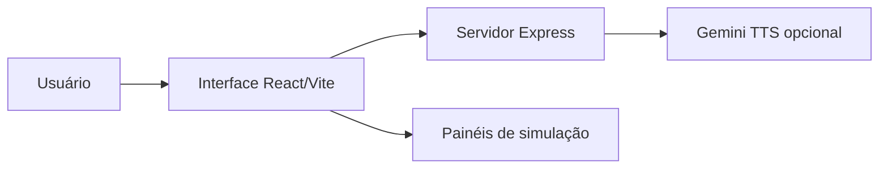

 |  | 

# Cristal 5D — Simulador Web

## Visão geral

Aplicação web React que apresenta uma simulação visual interativa de etapas de armazenamento em cristal 5D. metadata.json descreve-a como simulador/documentário e visualizador do processo e do arquivamento soberano DREX. O código expõe etapas e painéis simulados; não há evidência suficiente para afirmar que controla gravação física em cristal ou se conecta a uma rede DREX real.

## Objetivo e valor

**Problema/escopo:** Simulador web interativo em React para visualizar etapas conceituais de armazenamento de dados em cristal 5D.

**Valor verificável hoje:** o repositório torna explícitos seus artefatos, interfaces e limitações para que mantenedores e contribuidores possam avaliar o que existe sem confundir demonstração, proposta e produção.

## Arquitetura e tecnologias

Arquitetura não documentada no README. A árvore e os arquivos sugerem SPA React em src/ servida por Vite e uma camada Express em server.ts; esta define POST /api/tts, usando @google/genai. Há componentes de interface separados em src/components e a entrada é src/main.tsx. Essa descrição deriva da estrutura/código, não de documentação arquitetural publicada.

- TypeScript (linguagem predominante reportada pelo GitHub), React 19 e JSX/TSX.
- Vite 6 para desenvolvimento/empacotamento do cliente e Tailwind CSS 4.
- Node.js, Express 4 e tsx no servidor; @google/genai é usado na rota de síntese de áudio/TTS.
- Dependências também incluem D3, Recharts, Motion e jsPDF; CSS e HTML são reportados pelo GitHub como linguagens secundárias.

## Início rápido

Os comandos abaixo refletem instruções, manifestos ou pontos de entrada presentes no repositório. Dependências externas, segredos e serviços estão indicados quando aplicável; a presença de um comando não equivale a uma execução validada.

1. README declara Node.js como pré-requisito.
2. README indica instalar dependências com `npm install`.
3. README instrui configurar GEMINI_API_KEY em `.env.local`; `.env.local` não aparece na árvore pública, e `.env.example` fornece uma chave fictícia de exemplo.
4. README indica iniciar localmente com `npm run dev`; package.json associa esse script a `tsx server.ts`. Os comandos foram confirmados estaticamente, não executados na revisão estática do repositório.

## Exemplo de uso

Após iniciar localmente conforme o README, use a interface para selecionar uma das cinco etapas exibidas no painel “Fluxo do Processo” (Entrada Bruta, Refino de Pureza, Injeção de Elementos, Gravação em 5D, Sincronização de Armazenamento) e alternar os painéis Ledger, Prompt, Ciência, Dopagem ou Impacto. Esses controles e rótulos estão no código da interface; representam a simulação, não comprovam operação de hardware ou integração DREX.

## Estado e limitações

**Maturidade indicada:** Demonstração.

- Não afirmar gravação, armazenamento, sincronização ou conexão reais com cristal 5D/DREX: os rótulos/status de interface são parte da simulação, sem comprovação de backend ou rede correspondente.
- A rota POST /api/tts é observável em server.ts e exige GEMINI_API_KEY para essa chamada; não confundir isso com integração Gemini para todos os recursos do app.
- O workflow webpack.yml executa `npm install` e `npx webpack`, mas package.json declara Vite/esbuild e não declara webpack como dependência nem script de build correspondente; a configuração parece desalinhada e não foi executada.
- O workflow SLSA cria arquivos de texto genéricos `artifact1` e `artifact2`; não demonstra empacotamento dos artefatos reais da aplicação.

## Contribuição

Leia [CONTRIBUTING.md](CONTRIBUTING.md) antes de abrir uma issue ou pull request. Para reportes de segurança, siga a orientação específica do repositório, se houver.

## Licença

Este repositório está licenciado sob **MIT**; consulte [LICENSE](LICENSE).

## Patrocínio e apoio

O desenvolvimento aberto exige tempo para manutenção, documentação, testes, revisão de contribuições e resposta a issues. Se este projeto for útil, considere apoiar a continuidade pelo [GitHub Sponsors](https://github.com/sponsors/felipetjmg1-bit). O apoio não representa promessa de funcionalidades, prazo de entrega ou suporte comercial.

